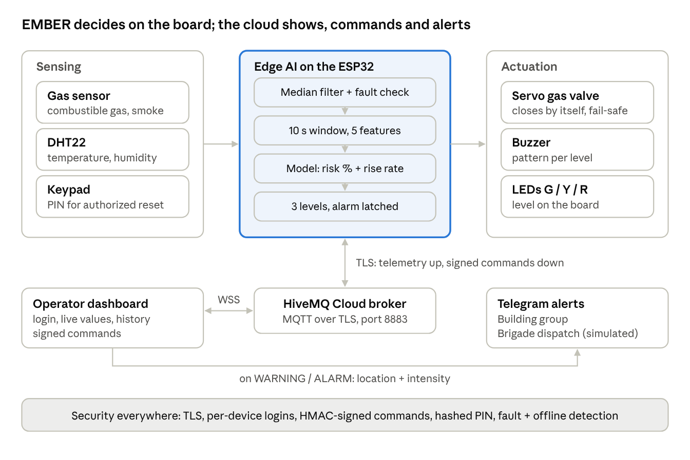

EMBER — IoT Spark 4.0 Fire Detection: Team System Brief
EMBER — IoT Spark 4.0 Fire Detection:
Team System Brief
Nov 8, 2026 · @Mayssam Hergli
What we're building
EMBER is a fire early-warning node. It reads gas, heat and humidity, has a small AI model
on the ESP32 decide the risk over a 10-second window, raises one of 3 levels, closes the
gas valve by itself, and alerts the fire brigade. All traffic is encrypted and every command
is signed.
Property 3, Fire Detection. Mission: find the early signs of a fire, sound a clear alarm, help
reduce the danger.
Rules that shape everything:
No real fire, flame or smoke at the event. No lighter flame, no match. The organizers
will show the safe test methods, and we train the model on exactly those.
Low voltage only. Keep water away from wires.
Budget: 490 credits. Parts list approved only if it has at least 2 sensors of different
kinds, 1 actuator and 1 board, and the plan says how we protect the system.
The jury may run an unannounced failure test during the day: a lost sensor, a fake
command or a lost connection. The system must handle all three.
Where the 100 points are: pitch + demo 30 · build and prototype 24 · plan and design 13 ·
AI 12 · security 10 · dashboard 6 · technical understanding 5. Doing the basics very well
beats unfinished advanced objectives.
Our approach: nail all 4 targets and all 6 layers first. The fire brigade alert is the one extra
we add on top. Security is built in and explained on a slide, not demoed.
Targets and how we meet them
Every target maps to a part or a function we can point at during the technical check.
Page 1 of 16

EMBER — IoT Spark 4.0 Fire Detection: Team System Brief
| Target | Requirement | How EMBER meets it | What the jury sees |
| ------ | ----------- | ------------------ | ------------------ |
Levels 3 danger levels on the NORMAL / WARNING / Readable in 1
|     | dashboard and on the | ALARM. Board: green,     | second |
| --- | -------------------- | ------------------------ | ------ |
|     | board                | yellow, red LED + buzzer |        |
pattern. Dashboard: full-
width colored banner
Response Alarm within 20 s of the 10 s sliding window Live timer: "alarm
|     | test condition | updated every 1 s; ALARM | raised in X s" |
| --- | -------------- | ------------------------ | -------------- |
after 3 s sustained
Reliability No alarm in normal Gas warm-up + baseline Hair dryer alone or
conditions during the calibration, median filter, breath: stays green
|     | whole demo | 3-window persistence, |     |
| --- | ---------- | --------------------- | --- |
hysteresis, model trained
on nuisance cases
Reset Only an allowed person ALARM latches. Reset = Wrong PIN refused
|     | can reset | keypad PIN at the panel, | and logged |
| --- | --------- | ------------------------ | ---------- |
or safety-officer login +
signed command from the
dashboard
Advanced objectives we cover cheaply: risk level + how fast it rises (the model outputs
risk % and its rise rate) · faulty sensor detection (built into sensing). We skip the two-
room objective unless the core is finished early.
Parts list: exactly 490 credits
The plan below spends all 490 credits. If we already bought parts, keep this list as the
target and map what we actually have onto it.
| Part      | Qty Credits | Why we need it           | Plan B if sold out     |
| --------- | ----------- | ------------------------ | ---------------------- |
| ESP32 dev | 1 150       | WiFi for encrypted MQTT, | Arduino Uno (100) +    |
| board     |             | enough pins, runs the    | laptop as gateway over |
|           |             | model                    | USB                    |
Page 2 of 16

EMBER — IoT Spark 4.0 Fire Detection: Team System Brief
| Part | Qty Credits | Why we need it | Plan B if sold out |
| ---- | ----------- | -------------- | ------------------ |
Gas sensor 1 90 Early sign: combustible None equivalent. Fall
|     |     | gas / smoke. Only 4 in | back to DHT22 + LDR |
| --- | --- | ---------------------- | ------------------- |
stock: buy it first
| DHT22 | 1 70 | Temperature rise + | LDR as second sensor |
| ----- | ---- | ------------------ | -------------------- |
|       |      | humidity drop      | kind                 |
Servo motor 1 70 Actuator: closes the gas Buzzer + LEDs as the
|     |     | valve / fire damper by | actuator, add LDR (30) |
| --- | --- | ---------------------- | ---------------------- |
itself
Matrix keypad 1 50 Local PIN: only an allowed Push button (10) + LDR
|        |      | person resets at the panel. | (30) + switch (10); reset |
| ------ | ---- | --------------------------- | ------------------------- |
|        |      | Only 2 in stock             | via dashboard login only  |
| Buzzer | 1 20 | Siren, distinct pattern per | none                      |
level
| LEDs: green,  | 3 30 | 3 levels shown on the  | Fewer LEDs + buzzer |
| ------------- | ---- | ---------------------- | ------------------- |
| yellow, red   |      | board                  | patterns            |
| Extra wires,  | 1 5  | Sensors and servo need | Starter pack wires  |
| male-female   | pack | male-female            |                     |
| Extra wires,  | 1 5  | Keypad header          | Starter pack wires  |
| female-female | pack |                        |                     |
Total 490
Free starter pack: breadboard, 30 jumper wires, resistors, USB power.
Checks: 2 sensors of different kinds (gas + DHT22), 1 actuator that acts by itself (servo;
buzzer too), 1 board. OK.
Not bought, and why: OLED (120): LEDs already show the 3 levels. Relay (80) and fan (80):
too expensive for what they add. RFID (90): the keypad does authorized reset for 50.
Architecture
The board detects, decides and acts on its own; the cloud is for showing, commanding and
alerting. That's what keeps the alarm working when the network fails.
Page 3 of 16

EMBER — IoT Spark 4.0 Fire Detection: Team System Brief
EMBER architecture · 6 layers
The six layers: sensing (gas, DHT22, keypad) · edge AI (filter, window, model, levels on the
ESP32) · actuation (servo valve, buzzer, LEDs) · communication (MQTT over TLS / WSS via
HiveMQ) · operator interface (dashboard + Telegram alerts) · security (across every
layer).
Wiring
Analog sensors go on ADC1 pins only (32–39), because ADC2 stops working when WiFi is
on. All grounds are shared.
Part ESP32 pin Notes
Gas sensor AO GPIO 34 Module is powered from 5V (VIN), so AO can
exceed 3.3V: use a 10k / 20k voltage divider.
Power it as early as possible: it needs warm-up
DHT22 data GPIO 4 3.3V. 10k pull-up to 3.3V if it's a bare sensor
(modules have one)
Page 4 of 16

EMBER — IoT Spark 4.0 Fire Detection: Team System Brief
| Part | ESP32 pin | Notes |
| ---- | --------- | ----- |
Servo signal GPIO 13 Servo power from 5V (VIN), not 3.3V. Common
GND
| Buzzer | GPIO 25 | Through a resistor if it's loud or draws much |
| ------ | ------- | --------------------------------------------- |
current
| LED green / yellow / | GPIO 26 / 27 / 14 | 220 Ω each |
| -------------------- | ----------------- | ---------- |
red
| Keypad rows 1–4 | GPIO 19, 18, 23, |     |
| --------------- | ---------------- | --- |
22
| Keypad cols 1–4 | GPIO 21, 17, 16, |     |
| --------------- | ---------------- | --- |
32
On-board BOOT GPIO 0 Local silence only (acknowledge), never reset
button
| Plan B: LDR divider | GPIO 35 | LDR to 3.3V, 10k to GND |
| ------------------- | ------- | ----------------------- |
| Plan B: push button | GPIO 33 | INPUT_PULLUP, to GND    |
Avoid GPIO 0, 2, 5, 12, 15 for anything else: they are boot strapping pins.
Detection logic
The ESP32 decides on its own, every second. The dashboard only shows and commands; it
is never needed for the alarm to work.
Sampling: sensors read at 10 Hz. A median filter over the last 5 readings removes spikes,
so one strange reading never starts an alarm. DHT22 is read every 2 s (its maximum rate).
Calibration: after the gas warm-up, the first 30 s learn the room's baseline (gas,
temperature, humidity). The baseline drifts slowly while everything is calm, and is frozen
during WARNING or ALARM.
Window: every 1 s, compute features over the last 10 s, run the model, get a risk % and its
rise rate (change of risk over 10 s).
Page 5 of 16

EMBER — IoT Spark 4.0 Fire Detection: Team System Brief
Level Board Enters when Leaves when
NORMAL green LED risk < 30% for 10 s
and no fault
WARNING yellow LED blinking, short risk ≥ 40% for 3 s, risk < 30% for 10 s
beep each second or a sensor fault
ALARM red LED strobe, siren, risk ≥ 75% for 3 s Latched. Only an
servo closes the valve, authorized reset, and only
brigade alerted once risk < 30%
Silence vs reset: silence (BOOT button or dashboard) stops the siren but keeps the
ALARM. Reset clears it and needs authorization.
Sensor faults (detected, never silent):
DHT22 returns NaN 3 times in a row → TEMP/RH FAULT
Gas reading stuck at 0 or 4095, or perfectly flat for 30 s → GAS FAULT
A faulted sensor's features are set to their neutral value, the model keeps running on
the sensors that still work, and the level goes to at least WARNING with the cause
"SENSOR FAULT: gas"
Safe states:
Failure What EMBER does
Loss of WiFi / broker Keeps detecting and alarming locally. After 10 s
offline the valve goes CLOSED (fail-safe).
Dashboard shows NODE OFFLINE via the Last Will
message
Sensor fault WARNING + fault cause, degraded mode, never
reports "all OK"
Boot / reboot Valve CLOSED until calibration ends, then opened
if NORMAL
Power loss (real product) Spring-return valve closes by itself. The prototype
servo holds its position: say this in Q&A
Page 6 of 16

EMBER — IoT Spark 4.0 Fire Detection: Team System Brief
Manual control from the dashboard: open/close valve, test siren, silence, reset. A manual
valve open is refused during ALARM unless the safety officer forces it.
AI model and the AI standard
A logistic regression on a 10 s window, running on the ESP32: simple, fast, and every
member can explain it in one sentence.
One-sentence explanation (everyone learns this): the model adds up weighted evidence
from 5 signals over the last 10 seconds and turns the total into a fire-risk probability; the
weights are learned from labeled recordings we made ourselves.
Inputs (features over the 10 s window):
1. Gas level above baseline
2. Gas slope (how fast it rises)
3. Temperature above baseline
4. Temperature slope
5. Humidity slope (fires dry the air; breath and steam make it rise, which helps reject
false alarms)
Plan B with an LDR: add light change as feature 6.
Output: risk 0–100% + rise rate. The levels come from the risk (see Detection logic).
Why this model suits fire detection: it reads several signals together, so heat alone (hair
dryer) or humidity alone (breath) does not trigger it, while heat + gas together does. It is
tiny, runs on the board in microseconds, and its weights show which signal matters most.
The 5 steps of the AI standard
1. Window: the model reads 10 s of readings, not one value. The dashboard shows the
live window and the model's answer.
2. Data and test: record labeled windows with the dashboard recorder, about 60 s per
label, several takes:
NORMAL (room, people around)
NUISANCE_HEAT (hair dryer at a distance, hand on the sensor)
NUISANCE_HUMID (breath, warm cup)
FIRE_SIGNS (the organizers' safe test condition) Hold out 25% as the test set.
That's far more than the 20 labeled windows required.
Page 7 of 16

EMBER — IoT Spark 4.0 Fire Detection: Team System Brief
3. Count the errors: confusion matrix + accuracy, precision, recall on the test set. Same
table for a plain threshold rule (gas > X or temperature > 50 °C) next to ours.
4. Key metric = recall on FIRE_SIGNS. A missed fire can cost lives; a false alarm costs an
evacuation and trust. We keep precision high enough to meet the "no false alarm
during the demo" target. Failure modes to explain: a very slow smoldering fire (gas
rises slowly), a sensor that has not finished warming up, conditions never seen in
training.
5. Explain it: inputs, output, when it can be wrong (above). Every member can say it.
Files to show the jury: the data CSVs, train.py , the model file (weights + normalization),
the confusion matrix image, the metrics table.
Communication and security contract
This section is the contract between firmware, dashboard and ML. Copy it into
CONTRACT.md at the repo root; nobody changes it without telling the other two.
Transport: ESP32 → WiFi → MQTT over TLS to HiveMQ Cloud (free tier), port 8883, with
the broker's root CA pinned on the ESP32. Dashboard → MQTT over secure WebSockets
(port 8884). If the venue WiFi blocks it, use a phone hotspot. Keepalive 5 s.
Broker accounts (separate logins, least privilege):
ember-node : publish telemetry / event / status, subscribe cmd
ember-dash : subscribe telemetry / event / status, publish cmd
Topics:
Topic Direction Content
ember/room1/telemetry node → dash, live values, risk, level
every 1 s
ember/room1/event node → dash level changes, faults, commands
accepted or rejected, PIN attempts,
resets
ember/room1/status node → dash, online on connect; offline as the Last
retained Will
ember/room1/cmd dash → node signed commands
Page 8 of 16

EMBER — IoT Spark 4.0 Fire Detection: Team System Brief
Telemetry payload:
{"seq":1532,"ts":1762617600,"temp":24.1,"rh":45.2,"gas":1210,"gas_d":35,
 "risk":0.12,"rise":0.01,"level":0,"cause":"","faults":[],
 "valve":"open","siren":0,"silenced":0,"f":[0.1,0.0,0.2,0.0,-0.1]}
level : 0 NORMAL, 1 WARNING, 2 ALARM ·  f : the 5 features, used by the data recorder.
Event payload:
{"ts":1762617600,"type":"LEVEL|FAULT|CMD_OK|CMD_REJECTED|PIN_FAIL|RESET|SILEN
CE","detail":"..."}
Command payload (signed):
{"cmd":"reset","user":"officer","ts":1762617600,"nonce":"a91f03c2","sig":"
<hex>"}
| sig  = HMAC-SHA256(role key,  | cmd|user|ts|nonce |     | )   |     |
| ----------------------------- | ----------------- | --- | --- | --- |
The ESP32 gets real time from NTP. It rejects a command if the signature is wrong, if
ts  is more than 30 s off, or if the nonce was already used (keeps the last 32). Every
| rejection is published as a  | CMD_REJECTED |  event. |     |     |
| ---------------------------- | ------------ | ------- | --- | --- |
Commands:  silence ,  siren_test ,  valve_open ,  valve_close  (operator key) ·
| reset ,  valve_force_open |  (officer key only) |     |     |     |
| ------------------------- | ------------------- | --- | --- | --- |
Keys live in  firmware/secrets.h  and are typed in at dashboard login. Never commit
them:  secrets.h  is in  .gitignore , the repo has  secrets.example.h .
Local reset: keypad PIN +  # . The PIN is stored on the ESP32 as a SHA-256 hash, not in
| clear. 3 wrong PINs = 60 s lockout +  | PIN_FAIL |  event. |     |     |
| ------------------------------------- | -------- | ------- | --- | --- |
Threats and the protections we built:
| Threat           | Impact           | Protection  |     | Where      |
| ---------------- | ---------------- | ----------- | --- | ---------- |
| Fake or replayed | People stay in a | HMAC-signed |     | firmware + |
command (someone burning building commands, timestamp + dashboard
| silences or resets the |     | nonce, role keys |     |     |
| ---------------------- | --- | ---------------- | --- | --- |
alarm during a fire)
Eavesdropping or Wrong status TLS to the broker, pinned broker +
tampering with readings in shown, fire CA, per-device firmware
| transit | hidden | credentials with least |     |     |
| ------- | ------ | ---------------------- | --- | --- |
privilege
Page 9 of 16

EMBER — IoT Spark 4.0 Fire Detection: Team System Brief
Threat Impact Protection Where
Unauthorized reset at the Alarm cleared by Keypad PIN (hashed), firmware
panel anyone lockout, logged
System blinded: sensor Fire not Fault detection, Last Will firmware +
unplugged or WiFi cut detected or not offline detection, local dashboard
reported autonomous alarm, fail-
safe valve
Security is built and explained on one slide. It is not part of the demo, but the juror may
test it during the technical check.
Dashboard and fire brigade alert
One index.html in the browser. A non-expert must read the state in a few seconds.
Must have (scored, 6 pts + demo):
Login (user + role key). Operator or safety officer; buttons appear by role.
Giant 3-level banner: NORMAL green / WARNING yellow / ALARM red, with the
cause in plain words ("Gas and heat rising together").
Live values: gas Δ, temperature, humidity, risk % gauge, rise rate ("+18% in 10 s"), a 60
s chart.
Response timer: a "Test started" button; the dashboard shows the seconds from that
click to ALARM. Target < 20 s.
Health: each sensor OK / FAULT, node ONLINE / OFFLINE, valve state.
Event history: every level change, fault, command, rejection, reset, with time.
Commands: silence, test siren, valve open/close, reset (officer only). All signed.
Data recorder: pick a label, record, download CSV for training.
AI tab: confusion matrix image + metrics table, ours vs the threshold rule.
The one extra: fire brigade alert (Telegram):
One bot, two groups: EMBER Building and Protection Civile Dispatch (SIMULATED).
Never alert a real emergency number.
WARNING → building group only. ALARM → automatic dispatch to the brigade group.
Page 10 of 16

EMBER — IoT Spark 4.0 Fire Detection: Team System Brief
The brigade message has the location (site, building, floor, room + a GPS map pin), the
intensity (level, risk %, rise rate, how long it has been in ALARM), the hazard ("gas
detected: valve closed automatically"), the time.
An inline "Dispatch acknowledged" button. On tap, the dashboard shows "Fire
brigade en route". No tap in 30 s → resend marked NOT ACKNOWLEDGED.
Back to NORMAL after reset → "Incident resolved" to both groups. Max 1 message per
10 s per group unless the level changes.
Prototype limit (say it in Q&A): the alert is sent by the dashboard, so it must be open.
In the real product a cloud function sends it.
Demo script
About 2.5 minutes inside the 5-minute pitch. Fire only, using the organizers' safe test
method. Rehearse it 3 times before 17:00.
1. Normal. Everything green, live values moving. "EMBER has learned this room's
normal."
2. False alarm rejected. Hair dryer alone, or breath on the sensor → stays green; the
dashboard says why ("heat only" / "humidity only"). "A simple threshold would have
fired here."
3. Early signs. Click "Test started", apply the organizers' test condition → risk % climbs,
rise rate shows → WARNING: yellow, slow beep, building group notified.
4. Alarm. Risk sustained → ALARM: red strobe, siren, servo closes the gas valve. Timer:
"alarm raised in X s" (target < 20 s).
5. Fire brigade. The judge holding the dispatch phone receives the alert: location,
intensity, map pin. They tap "Dispatch acknowledged" → the dashboard shows "Fire
brigade en route".
6. Authorized reset. "Only the safety officer can clear this." Enter the PIN on the keypad
→ back to green, "Incident resolved" sent.
7. AI slide. Confusion matrix, recall as the key metric, our model vs the threshold rule.
Before the pitch: gas sensor powered for at least 20 minutes, dashboard logged in, judge's
phone in the dispatch group, demo mode ready as a backup if the hardware fails.
Page 11 of 16

EMBER — IoT Spark 4.0 Fire Detection: Team System Brief
Team, repo and Claude workflow
Three people, three laptops, three Claudes, one repo. Each person owns one folder and
only edits that folder.
Who Owns Folder Claude
A: Hardware + wiring, ESP32 code, model weights /firmware Claude
firmware flashed Code #1
B: Cloud + dashboard HiveMQ accounts, dashboard, /dashboard Claude
+ security signed commands, Telegram alert Code #2
C: AI + pitch data recording, training, /ml , Claude #3
evaluation, slides, demo script, /pitch
submission
Repo layout:
ember/
README.md ← this brief
CONTRACT.md ← the communication and security contract (section
above)
.gitignore ← includes firmware/secrets.h
firmware/ember/ ← ember.ino, model.h, secrets.example.h
dashboard/ ← index.html
ml/ ← data/*.csv, train.py, report/ (confusion matrix,
metrics)
pitch/ ← slides, demo script, Q&A notes
Starting points: the v2 ember_firmware.ino , dashboard.html and train.py from the
chat. They already have the sampling, the model, the state machine, the recorder and the
demo mode. Adapt them, don't start over.
Rules to save Claude usage:
Every prompt starts with: "Read README.md and CONTRACT.md. Only touch /<your
folder>."
One task per prompt. Ask for edits, never a full-file rewrite.
Paste only the error lines, never whole logs.
Commit small, pull before every prompt. A contract change goes in the team chat
first.
Page 12 of 16

EMBER — IoT Spark 4.0 Fire Detection: Team System Brief
Prompt for Claude Code #1 (firmware):
Read README.md and CONTRACT.md. Only touch /firmware. Starting from ember.ino
(v2), adapt it to this brief:
- Parts: gas sensor (GPIO34), DHT22 (GPIO4, temp + humidity), servo valve
(GPIO13), buzzer (25),
LEDs G/Y/R (26/27/14), 4x4 keypad (rows 19,18,23,22; cols 21,17,16,32).
Remove LCD, RFID, fan, motor, flame.
- 10 Hz sampling with a 5-sample median filter; 10 s window every 1 s; 5
features as in README; logistic model
weights in model.h; risk + rise rate.
- 3 levels NORMAL/WARNING/ALARM with the thresholds, persistence, hysteresis
and latch in README.
- Sensor fault detection and safe states exactly as in README (valve closes
after 10 s offline).
- WiFi + MQTT over TLS (WiFiClientSecure + PubSubClient, HiveMQ root CA),
Last Will on ember/room1/status, NTP time.
- Telemetry/event/cmd payloads exactly as CONTRACT.md. HMAC-SHA256 command
check with mbedtls, 30 s window,
nonce cache of 32, role keys from secrets.h.
- Keypad PIN reset (SHA-256 hash stored), 3 failures = 60 s lockout.
Keep Web Serial JSON output as a fallback. Give me the libraries to install.
Prompt for Claude Code #2 (dashboard):
Read README.md and CONTRACT.md. Only touch /dashboard. Starting from
dashboard.html (v2), rebuild it as index.html:
- Connect with MQTT over WSS (mqtt.js, HiveMQ, port 8884); keep Web Serial +
demo mode as fallbacks.
- Login screen (user + role key, kept in memory only); role-based buttons.
- Everything in the README "Dashboard" must-have list: 3-level banner with
plain-words cause, live values,
risk gauge + rise rate, 60 s chart, response timer, sensor health,
online/offline, event history, signed commands
(HMAC-SHA256 via Web Crypto, payload exactly as CONTRACT.md), data
recorder, AI tab.
- Remove camera, RFID headcount, flame features.
- Then the Telegram fire brigade alert exactly as README (two groups,
location + intensity, ack button, 30 s re-send).
Prompt for Claude #3 (ML):
Page 13 of 16

EMBER — IoT Spark 4.0 Fire Detection: Team System Brief
Read README.md. Only touch /ml. Adapt train.py to the 5 features and labels
NORMAL, NUISANCE_HEAT, NUISANCE_HUMID,
FIRE_SIGNS (only FIRE_SIGNS is positive). Output: confusion matrix PNG,
accuracy/precision/recall/F1 for our model
and for a threshold rule (gas_d > X or temp > 50), per-label false alarm
rate, and model.h with weights + mean/std.
Timeline
Code freeze at 17:00, when Final Inspection starts. Tick these off as they land.
15:00 Everyone: repo + README + CONTRACT.md pushed. A: gas sensor powered. C:
ask the organizers what the safe test condition is
15:00 B: HiveMQ cluster + 2 accounts + Telegram bot and 2 groups created
15:40 checkpoint Live telemetry over TLS showing on the dashboard
16:00 C: data recorded for all 4 labels, several takes each
16:15 checkpoint Trained model flashed; 3 levels, latch, keypad reset, signed
commands, fault detection all work
16:30 Fire brigade alert working end to end
16:40 Failure drills: unplug the DHT22, kill the WiFi, send an unsigned command. Each
one handled
16:50 Full demo rehearsed 3 times
17:00 Code freeze. Technical check: each member explains their part
before 17:30 Slides submitted through link 2
Real life, pitch and open items
Prototype vs the real product:
Prototype Real deployment What stays the same
Gas sensor + DHT22 Certified multi-sensor detector Several signals fused, not one
per room (optical smoke + heat threshold
+ CO)
Logistic model on Same edge model, retrained on Decision made locally, works
the ESP32 certified test fires, per room without network
Page 14 of 16

EMBER — IoT Spark 4.0 Fire Detection: Team System Brief
Prototype Real deployment What stays the same
Servo Motorized gas valve with spring Automatic shutoff + manual
return (fail-closed) override + safe state
LEDs + buzzer Sounders and beacons 3 clear levels
HiveMQ + browser Building gateway with battery Encrypted transport, signed
dashboard backup, LTE fallback, cloud commands, offline detection
function sending alerts
Telegram dispatch Certified alarm receiving centre Location + intensity sent
group forwarding to Protection Civile automatically, acknowledged
Unit cost: C to estimate before the pitch, per room node and per building (detector, MCU,
enclosure + battery, valve per gas zone, gateway, cloud). Present it as a rough order of
magnitude and label it that way.
Pitch outline (5 min):
1. 0:00 Problem: fires start small and nobody sees them in time. One line from the
property card.
2. 0:30 EMBER in one sentence + the 6-layer architecture slide.
3. 1:00 Live demo (Demo script).
4. 3:30 AI slide: window, confusion matrix, recall, our model vs threshold.
5. 4:00 Security slide: 4 threats → 4 protections.
6. 4:30 Real deployment + unit cost. Close on the brigade alert.
Q&A to prepare (each owner answers their own):
Why logistic regression and not a neural network? (C)
What if the WiFi goes down during a fire? (A)
What if someone unplugs a sensor? (A)
How do you stop someone silencing the alarm remotely? (B)
Why recall as the key metric, and what does a false alarm cost? (C)
Why does the servo stay in place on power loss, and what would the real valve do? (A)
Why is the dashboard needed to send the alert? (B)
Open items:
Our Constraint Card: what rule does it add, and does this plan follow it?
Page 15 of 16

EMBER — IoT Spark 4.0 Fire Detection: Team System Brief
Exact parts actually bought (adjust the BOM and pins if different)
The organizers' safe test condition (train on it)
Telegram reachable on the venue WiFi, or use a phone hotspot
Page 16 of 16

## Extracted Images

### Page 4

