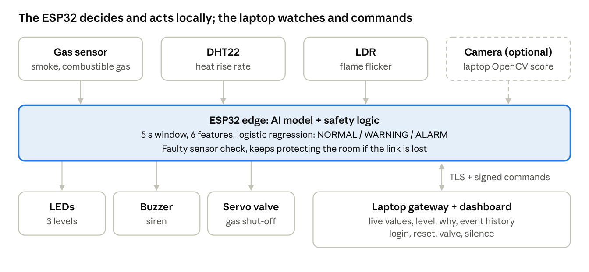

EMBER — fire intelligence at the first flicker
EMBER — fire intelligence at the first flicker
Nov 8, 2026 · @sami
Team
Field Answer
Team name [to fill]
Property 3 — Fire Detection
Members [Member A], [Member B], [Member C]
Team leader [to fill]
Constraint card [write the card's rule here + one line on how
EMBER follows it]
Member A = hardware and firmware. Member B = AI and data. Member C = dashboard,
security and pitch. With 2 members, B and C merge.
EMBER in simple words
EMBER is a room detector that spots the early signs of a fire, tells a real danger apart
from false alarms, sounds a clear alarm and closes the gas before things get worse.
1. It watches three signs at once: gas or smoke in the air, heat that rises fast, and the
flicker of a flame.
2. A small AI model decides. Every 0.5 s it reads the last 5 seconds of readings and gives
a danger level: NORMAL, WARNING or ALARM. Gas alone means a leak (WARNING).
Gas + fast heat + flicker means fire (ALARM).
3. It is not fooled. A flashlight is bright but steady. A warm hand is heat with no flame.
One odd reading never starts the alarm.
4. It acts on its own, with no internet: green, yellow or red LED, a different siren for each
level, and the gas valve closes.
5. It tells people. The dashboard shows live values, the level, why it decided, and the
event history.
Page 1 of 7

EMBER — fire intelligence at the first flicker
6. Only an allowed person can reset it, from the dashboard with a login. Every command
is signed, so a fake command is rejected.
7. It keeps working when a part fails. A broken sensor is reported as a fault. If the
connection drops, the board keeps protecting the room on its own.
The problem in our own words
Who is affected: families in homes that cook with butane bottles, small restaurants and
workshops, and the building managers responsible for them.
What can fail: a gas leak goes unnoticed and turns into an explosion or a fire. A small fire
starts at night or in an empty room and nobody sees it in time. Classic detectors give false
alarms, so people ignore them or unplug them. A detector that only beeps locally helps
nobody when the room is empty.
What it costs: lives and injuries first, then the home or business, its stock and its income.
Every minute of early warning gives people more time to leave and stops a small fire from
becoming a big one.
Our six layers
Layer What we will do Who is in
charge
Sensing Three sensors of different kinds: gas sensor Member A
(smoke and combustible gas), DHT22
(temperature, used for how fast heat rises),
LDR sampled fast (flame flicker). Plausibility
checks flag a faulty or disconnected sensor:
DHT22 returns no value, gas reading stuck at 0
or max, LDR flat. One odd reading never starts
an alarm: decisions use a 5 s window.
Communication The ESP32 sends a reading packet every 0.5 s Member C
over Wi-Fi to the laptop gateway, and receives
commands back. Traffic is protected with
HTTPS (TLS, pinned certificate). Every
command is also signed with HMAC-SHA256
plus a counter, so a copied or replayed
command is rejected.
Page 2 of 7

EMBER — fire intelligence at the first flicker
Layer What we will do Who is in
charge
Edge processing and A logistic regression model runs on the ESP32. It Member B
AI reads a 5 s window (10 readings) and computes
6 features: gas above baseline, gas slope, heat
slope, light change, flicker, camera flame score
(optional, laptop OpenCV). Output: probability
of normal, gas leak, fire, mapped to NORMAL /
WARNING / ALARM. Trained on data we record,
including traps (flashlight, warm hand). Tested
on at least 20 labeled windows with a confusion
matrix, accuracy, precision and recall. Key
metric: fire recall. Compared to a simple
threshold rule.
Actuation Automatic: LEDs green, yellow, red; buzzer with Member A
one pattern per level; servo as the gas shut-off
valve, closed at gas leak or fire. Manual: an
allowed user can open or close the valve and
silence the buzzer from the dashboard. Safe
state on failure or lost link: valve closed, local
alarm keeps running.
Security Threat 1: someone resets or silences the alarm Member C
without the right to (prank, intruder).
Protection: dashboard login, reset needs an
authorized account, the board's button can only
silence for 60 s, never reset. Threat 2: fake or
replayed commands on the network (for
example "open valve"). Protection: HMAC-
SHA256 signature + counter, rejected and
logged. Threat 3: eavesdropping or tampered
data in transit. Protection: TLS. Threat 4:
connection lost or jammed. Protection: the
board decides and acts alone.
Page 3 of 7

EMBER — fire intelligence at the first flicker
Layer What we will do Who is in
charge
Operator interface Web dashboard on the laptop: live values, a big Member C
colored status banner (NORMAL / WARNING /
ALARM), fire probability with "why" bars,
sensor fault indicators, event history,
commands (authorized reset, silence, valve
open or close). A non-expert reads it in a few
seconds.
Our architecture
EMBER architecture · sensing, edge AI, actuation, gateway
The board senses, decides and reacts without the laptop; the laptop adds the camera
score, the dashboard and authorized commands.
Target Where it is handled
Three danger levels Model output on the ESP32, shown on the LEDs
and the dashboard banner
Alarm within 20 s 0.5 s loop on a 5 s window: alarm in under 10 s
No alarm in normal conditions Model trained on traps (flashlight, warm hand) + 5
s window against odd readings
Page 4 of 7

EMBER — fire intelligence at the first flicker
Target Where it is handled
Only an allowed person resets Dashboard login + signed reset command; the
board button only silences for 60 s
Parts list
Total: 475 of 490 credits. Three sensors of different kinds, three kinds of actuators, one
board.
| Part | Role | Credits | Second choice if sold out |
| ---- | ---- | ------- | ------------------------- |
ESP32 development Brain, Wi-Fi, runs the 150 Arduino Uno (100), model runs
| board | model |     | on the laptop over USB |
| ----- | ----- | --- | ---------------------- |
Gas sensor Smoke and combustible 90 None in the bank: keep DHT22
|     | gas |     | + LDR, buy the second-choice |
| --- | --- | --- | ---------------------------- |
relay with the saved credits
| DHT22 | Temperature, heat rise | 70  | None in the bank: gas + LDR |
| ----- | ---------------------- | --- | --------------------------- |
|       | rate                   |     | still give two sensors      |
LDR light sensor Flame flicker 30 Infrared obstacle sensor (40)
Servo motor Gas shut-off valve 70 Small fan (80) as a vent, gas
leak only
| Buzzer | Siren, one pattern per | 20  | LEDs only |
| ------ | ---------------------- | --- | --------- |
level
LED red, yellow, Danger level on the 30 Fewer LEDs + level shown in
| green       | board                   |     | the buzzer pattern |
| ----------- | ----------------------- | --- | ------------------ |
| Push button | Local silence for 60 s, | 10  | Dashboard only     |
never a reset
| Extra wires, male to | Spare wiring | 5   | Starter pack only |
| -------------------- | ------------ | --- | ----------------- |
female
Free starter pack: breadboard, 30 jumper wires, resistors, USB power. The laptop webcam
is ours, so the camera layer costs nothing.
Page 5 of 7

EMBER — fire intelligence at the first flicker
The real-life solution
In a real building, EMBER is one detector per room linked to a building gateway, a manager
dashboard and the emergency services.
Multi-sensor detector in each room: certified gas and smoke sensor, heat sensor,
infrared flame sensor, optional camera for visual confirmation.
AI on the detector: the same windowed model gives three levels and separates a gas
leak from a fire. It keeps working without internet.
Automatic reaction: loud siren and strobe, gas solenoid valve that closes, ventilation
shut down during a fire, power to the room cut.
Alerts: building manager notified at every level change. Pre-alert to Civil Protection
(198) at WARNING, dispatch at ALARM, with room, floor, intensity and the gas hazard.
Multi-room dashboard: every room on one screen, event history, sensor health.
Authorized reset only: user accounts with roles, signed commands, encrypted traffic.
Reliability: battery backup, sensor self-check reported as a fault, regular automatic
tests, certification before sale (EN 54 family in Europe).
How our prototype maps to the real solution
The prototype keeps the full chain (sense, decide, react, alert, authorized reset) and only
swaps parts for cheaper, safer ones.
What changes
Prototype Real solution Why the change
LDR reading flicker Infrared flame sensor Same signal (flicker), certified
and immune to room light
Hobby gas sensor Certified gas and smoke Precision, long-term stability,
sensor certification
Servo turning a model Gas solenoid valve, closed Real shut-off, fail-safe on power
valve without power loss
Flame video and unlit gas Real smoke, heat and No real fire is allowed at the
as test inputs flame event
Laptop as gateway and Building gateway + cloud Runs 24/7, many rooms
dashboard dashboard
Page 6 of 7

EMBER — fire intelligence at the first flicker
Prototype Real solution Why the change
Local Wi-Fi hotspot Building Wi-Fi or LoRa, TLS Range and reliability
One room, USB power One detector per room, Coverage and power cuts
mains + battery
What is preserved
The same three early signs: gas or smoke, heat rise rate, flame flicker.
The same AI: a model on the detector reading a 5 s window, three levels, leak vs fire.
The same safety logic: acts without internet, safe state on failure, faulty sensor
reported.
The same security: login, signed commands, encrypted traffic, authorized reset.
The same dashboard: live values, level, why, history, commands.
Why the prototype stays representative: the decision logic, the data flow and the
security model are identical. Only the sensors and the valve get better versions with the
same interface, so the code and the model carry over after retraining on real sensor data.
Estimated unit cost of the real deployment (approximate, to verify): about 100 to 160 DT
per room detector, plus about 60 to 100 DT per gas valve, plus one gateway per building.
Certification and installation come on top.
Page 7 of 7

## Extracted Images

### Page 4

