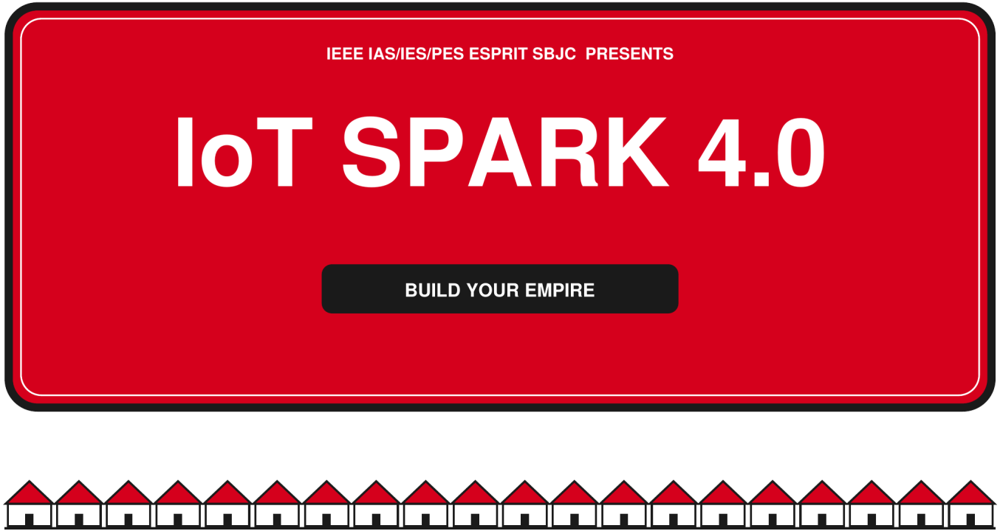

SPECIFICATION BOOK
Seven properties. Seven real problems. One Hardware Bank.
READ ME FIRST
This book explains the technical challenge of IoT Spark 4.0. It has seven properties. Each property is a real
engineering problem. At 12:00, your team draws one of them, and the time starts.
HOW TO USE THIS BOOK
• Read the whole book once. Read the Hardware Bank pages and the jury rules with care.
• When you draw your property, read its page again.
• Use the planning sheet at the end of the book during your 45 minutes of planning.
• Each team receives two links by email. The first link is for your plan, during Build Your Strategy.
The second link is for your presentation, at the end of Final Inspection, before you present to the
jury.
WHAT THIS BOOK DOES NOT TELL YOU
It does not tell you which parts to buy, how to build your system, how your devices talk to each other, or
which AI to use. Each property gives you a problem, a mission and some limits. You decide how to solve
it. The jury will ask you to explain your choices. Two teams with the same property should build two
different projects.
IoT Spark 4.0 | IEEE IAS/IES/PES ESPRIT SBJC | Specification Book | Page 1

THE GAME, STEP BY STEP
Time Square What you do
12:00 Pick Your Property Draw your Property Card and your Constraint Card.
Plan your solution and list the parts you need. You have 45
12:10 Build Your Strategy minutes. Submit your plan with the first link sent to your team's
email.
12:55 Race to the Bank Buy your parts with your Monopoly credits. The stock is limited.
13:15 Lay the Foundations Build your hardware.
Write the code, connect the devices, add AI and build your
14:00 Build Your Empire
dashboard. You have 3 hours.
Test everything and prepare your pitch. A juror visits each team
for a short technical check (about 5 minutes). Submit your
17:00 Final Inspection
presentation with the second link sent to your team's email,
before you present to the jury.
Present and demonstrate your prototype to the jury. You have 8
17:30 Pass GO, Collect Glory minutes: 5 minutes of pitch and 3 minutes of questions. Your
demonstration must fit the time.
Teams have 2 or 3 members. Before the Race to the Bank, the jury checks your plan and your parts list. If
your plan is approved, your team leader can go to the Hardware Bank. All approved teams go at the same
time, so it is a real race. A team that arrives late may find some items sold out.
THE THREE EVALUATION MOMENTS
• Plan check: before the Race to the Bank.
• Technical check: during Final Inspection, about 5 minutes per team.
• Final presentation: 5 minutes of pitch and live demonstration, then 3 minutes of questions.
TWO SUBMISSION LINKS
Each team receives two links by email. Link 1: submit your plan during Build Your Strategy, before the
plan check. Link 2: submit your presentation at the end of Final Inspection, before you present to the
jury.
CARDS AND RULES
Constraint Card. Each team draws one with its property. It adds one rule to your project. The rule is
explained when you draw the card. Your plan must follow it.
Change your property. You may re-draw once. A re-draw costs 50 credits, and the new card is final. Two
teams may also swap cards for free if both agree. All changes must be done before the plan check.
Chance and Community Chest. During the day, teams draw cards. Some cards bring bad luck. For
example, a teammate cannot work for 10 minutes, or you pay 20 credits. Some cards bring good luck. For
example, you get 30 extra credits, a free part or one question to a mentor. One card is the jury event: an
unannounced test of how your system handles a failure, for example a lost sensor, a fake command or a lost
connection.
IoT Spark 4.0 | IEEE IAS/IES/PES ESPRIT SBJC | Specification Book | Page 2

YOUR BUDGET AND THE HARDWARE BANK
MONOPOLY CREDITS FOR EVERY TEAM
490
Teams of 2 and teams of 3 get the same budget. Every board, sensor and
actuator has a price. You can find the full price list on the next two pages.
The stock is limited, and all teams share it.
FREE STARTER PACK
Every team gets these for free: one breadboard, 10 male-to-male, 10 male-to-female and 10 female-to-
female jumper wires, a set of resistors and USB power at the table. You can buy extra wires in the
Hardware Bank.
HOW BUYING WORKS
• Before the Race to the Bank, you submit your plan and your parts list with the first link, and the jury
checks them.
• Your parts list is approved when: the planning sheet is complete; the total cost is 490 credits or less (440
after a re-draw); every part is in the price list; the list has at least 2 sensors of different kinds, 1 actuator
and 1 board; and your plan says how you protect the system.
• Approved teams buy at the same time. The first to ask is the first served.
• A sold-out part cannot be bought. No part is guaranteed, so prepare a second choice.
• If a part is faulty when you get it, an organizer replaces it.
• Credits you do not spend are not points. The jury scores your choices, not your savings.
• A re-draw of your Property Card costs 50 credits from your budget.
ABOUT THE BOARDS
Two boards are available. Each board has different strengths and limits. Stock is limited, so a part you
want may be sold out. The jury scores how well you design with the board you have. It does not score
which board you have.
IoT Spark 4.0 | IEEE IAS/IES/PES ESPRIT SBJC | Specification Book | Page 3

HARDWARE BANK: PRICE LIST (1 OF 2)

Prices are in Monopoly credits. Stock is in units.
| BOARDS                   | Notes                | Price  | Stock  |
| ------------------------ | -------------------- | ------ | ------ |
| ESP32 development board  | Wi-Fi and Bluetooth  | 150    | 14     |
| Arduino Uno              | No Wi-Fi             | 100    | 5      |

| BREADBOARDS AND WIRES     | Notes                   | Price  | Stock  |
| ------------------------- | ----------------------- | ------ | ------ |
| Breadboard, starter pack  | One free for each team  | Free   | 11     |
Jumper wires, male to male  Starter pack: 10 for each team  Free  400
Jumper wires, male to female  Starter pack: 10 for each team  Free  200
Jumper wires, female to female  Starter pack: 10 for each team  Free  200
| Extra wires, male to male  | Pack of 10  | 5   | 10  |
| -------------------------- | ----------- | --- | --- |
Pack of 10
| Extra wires, male to female    |             | 5   | 10  |
| ------------------------------ | ----------- | --- | --- |
| Extra wires, female to female  | Pack of 10  | 5   | 10  |

| ENVIRONMENT SENSORS  | Notes                     | Price  | Stock  |
| -------------------- | ------------------------- | ------ | ------ |
| DHT22 sensor         | Temperature and humidity  | 70     | 8      |
| Gas sensor           | Needs warm-up time        | 90     | 4      |
| LDR light sensor     | Light level               | 30     | 8      |
| Water level sensor   | Detects water             | 60     | 4      |

| MOTION AND POSITION SENSORS  | Notes                           | Price  | Stock  |
| ---------------------------- | ------------------------------- | ------ | ------ |
| Ultrasonic sensor module     | Distance                        | 60     | 6      |
| Motion sensor module         | Movement of a person or object  | 80     | 5      |
| Infrared obstacle sensor     | Short-range detection           | 40     | 8      |
Accelerometer and gyroscope. Costly
| MPU6050  |     | 150  | 2   |
| -------- | --- | ---- | --- |
part

IoT Spark 4.0  |  IEEE IAS/IES/PES ESPRIT SBJC  |  Specification Book  |  Page 4

HARDWARE BANK: PRICE LIST (2 OF 2)

| IDENTIFICATION AND INPUT  | Notes                    | Price  | Stock  |
| ------------------------- | ------------------------ | ------ | ------ |
| RFID kit                  | Identification by badge  | 90     | 3      |
| Matrix keypad             | Key input                | 50     | 2      |
| Push buttons DS-316MM     | Press to send a signal   | 10     | 6      |
| Switch                    | On/off                   | 10     | 10     |

| ACTUATORS AND OUTPUTS      | Notes                   | Price  | Stock    |
| -------------------------- | ----------------------- | ------ | -------- |
| Buzzer                     | Sound                   | 20     | 3        |
| LED, red, green or yellow  | One color               | 10     | 10 each  |
| 1-channel relay module     | Switches a larger load  | 80     | 8        |
| Servo motor                | Moves to a set angle    | 70     | 6        |
| Mini water pump            | 12 V. Low voltage only  | 100    | 3        |
| Small fan                  | Low voltage only        | 80     | 3        |
| OLED display               | Text and graphics       | 120    | 4        |

| POWER AND BUILDING          | Notes               | Price  | Stock  |
| --------------------------- | ------------------- | ------ | ------ |
| LM2596 step-down regulator  | Lowers the voltage  | 40     | 9      |

R  esistors and USB power are part of the free starter pack. They are not sold.
IoT Spark 4.0  |  IEEE IAS/IES/PES ESPRIT SBJC  |  Specification Book  |  Page 5

THE SIX LAYERS
Every project is built with the same six functional layers. The table shows the minimum for every team. It
does not tell you how to build each layer. That is your design work. Your architecture must be coherent
across the six layers, and every target of your property must be traceable to a component or a function of
your system.
Layer What we expect from every team
At least two sensors of different kinds, relevant to the monitored physical quantity. The
Sensing readings change consistently with the physical input. One strange reading must not start
an alarm, and a faulty or disconnected sensor is detected and handled.
Data and commands travel between your devices and the operator interface in real time,
Communication
within the response threshold of your property. The traffic is protected in transit.
Edge A real AI model or service that reads a window of readings. A simple rule such as ‘if the
processing and value is above...’ is not enough. You may use a ready-made model. Follow the AI
AI standard on the next page.
At least one actuator that reacts by itself to the detected condition. A person can also
Actuation control it by hand from the operator interface. It has a defined safe state on failure or on
loss of communication.
Protect who can use the system, the data it sends and the commands it receives. Find
Security the risks that matter for your property (at least two realistic threats), and explain how you
protect against them with a protection you built.
The dashboard shows live values, a clear status, an alarm indication and an event
Operator
history. A person can send a command from it. A non-expert operator can read it within a
interface
few seconds.
PROTOTYPE AND REAL LIFE
You are building a prototype, not the final product. Think about how the real solution would look. Then
explain how your prototype copies the same idea in a smaller and cheaper way: what changes, what is
preserved, and why your prototype is still a good model of the real solution. Give an estimate of the unit
cost of the real deployment. Each property page gives some real-world facts to help you.
SAFETY FIRST
Use low voltage only. No real fire, flame or smoke. Keep water away from wires and power. If a part
breaks, gets hot or smells burnt, stop and call an organizer.
IoT Spark 4.0 | IEEE IAS/IES/PES ESPRIT SBJC | Specification Book | Page 6

THE AI STANDARD
Every property needs a real AI part. All teams follow the same standard, so the AI work is equal for
everyone.
Step What you do What you show
The model reads a window of readings. A window is a
short group of readings taken over time, not one The window and the answer
1. Use a window
single value. The model runs inside your live system, of the model. The model file.
and its answer changes when the input changes.
Test the model on at least 20 labeled windows, both
normal and abnormal. A labeled window is an
2. Test it Your test data.
example where you know the right answer, for
example ‘normal’ or ‘problem’.
Make a confusion matrix. This is a table that counts
3. Count the The table and the metrics,
the right and the wrong answers of your model. Then
errors and what the errors mean.
calculate accuracy, precision and recall.
Choose the metric that matters most for your property,
Your key metric and your
4. Choose your and say why. Analyse the failure modes: what a false
analysis of false alarms and
key metric alarm costs, what a missed event costs, and the limits
missed events.
of your model.
Say what goes into the model, what comes out, and
5. Explain it when it can be wrong. Explain why the model is suited Every member can explain it.
to your property.
GOOD TO KNOW
A simple model that you explain well scores higher than a strong model that you cannot explain. The
jury cares more about your understanding than about the numbers. The model can run on the board or
on a laptop. Both are scored the same. Comparing your model with a simple threshold rule is a good
way to show why you need a model, but it is not a separate scored step.
IoT Spark 4.0 | IEEE IAS/IES/PES ESPRIT SBJC | Specification Book | Page 7

HOW YOU WILL BE EVALUATED
Every team is evaluated with the same grid, whatever its property. The total is 100 points. Several jurors
score each team on their own, and their scores are averaged. The table shows the main areas.
Each team receives two links by email. The first link is for your plan, during Build Your Strategy. The
second link is for your presentation, at the end of Final Inspection, before you present to the jury.
Area Points What the jury looks at
Your understanding of the problem, your architecture, your choice
Plan and design 13
of parts and your budget.
Your sensors and actuators, and the targets of your property. They
Build and prototype 24
must work and keep working.
AI 12 A real model, tested and explained, that follows the AI standard.
Security 10 How you protect users, data and commands.
Operator interface 6 Your dashboard: live values, alerts, history and control.
Every member can explain their own part and the limits of the
Technical understanding 5
prototype.
Your pitch, your live demonstration, your teamwork and your time
Pitch and demonstration 30
management.
TOTAL 100
BASIC AND ADVANCED
The mission and the targets of your property are required. The advanced objectives on each property
page are optional, and they count inside the 100 points. Doing the basics very well is worth more than
starting advanced objectives and leaving the basics unfinished.
TECHNICAL CHECK (DURING FINAL INSPECTION)
A juror visits each team for about 5 minutes. Be ready to show your system working, including its
security and its AI, and to explain your own wiring, code and design choices.
IoT Spark 4.0 | IEEE IAS/IES/PES ESPRIT SBJC | Specification Book | Page 8

3
FIRE DETECTION
Property 3 of 7
THE PROBLEM
Most fires start small. The danger is that nobody sees them in time. Early detection gives people time to
leave safely.
YOUR MISSION
Find the early signs of a fire, sound a clear alarm and help reduce the danger.
TARGETS AND LIMITS
Target Requirement
The system shows three danger levels, for example normal, warning and alarm, on the
Levels
dashboard and on the board.
Response The alarm starts within 20 seconds after the test condition is applied.
Reliability No alarm in normal conditions during the whole demo.
Reset Only an allowed person can reset the alarm.
IN THE REAL WORLD
A real building has many rooms and strict safety rules. A real system is certified, tested often and must
keep working when a part fails.
ADVANCED OBJECTIVES (OPTIONAL) SAFETY RULES
• Estimate the risk level and how fast it rises No real fire, flame or smoke is
• Detect a faulty sensor allowed at the event. The organizers
will show you safe ways to test.
• Watch two rooms on one dashboard
IoT Spark 4.0 | IEEE IAS/IES/PES ESPRIT SBJC | Specification Book | Page 11

TEAM PLANNING SHEET

Use this sheet during Build Your Strategy. You have 45 minutes. Write short and clear answers. Submit it with the first
link sent to your team's email. The jury checks it at the plan check.
Each team receives two links by email. The first link is for your plan, during Build Your Strategy. The
second link is for your presentation, at the end of Final Inspection, before you present to the jury.

Team name:  Property:
Members:  Team leader:
Constraint card:

THE PROBLEM IN OUR OWN WORDS
Who is affected? What can fail? What does an incident or a loss cost?

OUR SIX LAYERS
| Layer    | What we will do  | Who is in charge  |
| -------- | ---------------- | ----------------- |
| Sensing  |                  |                   |
|          |                  |                   |
Communication
Edge processing
|     |     |     |
| --- | --- | --- |
and AI
|     |     |     |
| --- | --- | --- |
Actuation
| Security  |     |     |
| --------- | --- | --- |
Operator
|     |     |     |
| --- | --- | --- |
interface

OUR ARCHITECTURE
Sketch the six layers and show where each target of our property is handled (architecture diagram).
IoT Spark 4.0  |  IEEE IAS/IES/PES ESPRIT SBJC  |  Specification Book  |  Page 16

TEAM PLANNING SHEET (CONTINUED)

OUR PARTS LIST
How  Cost
| Part  |     | Why we need it  | Alternative if sold out  |
| ----- | --- | --------------- | ------------------------ |
many  (credits)
|     |     |     |     |
| --- | --- | --- | --- |
|     |     |     |     |
|     |     |     |     |
|     |     |     |     |
|     |     |     |     |
|     |     |     |     |
|     |     |     |     |
|     |     |     |     |

Total cost: ____________  Our budget: 490 credits (440 after a re-draw)  Estimated unit cost of the real deployment:
____________
HOW OUR PROTOTYPE MAPS TO THE REAL SOLUTION
What changes, what is preserved, and why the prototype stays representative.

OUR BIGGEST RISK AND OUR PLAN B (ALSO FOR SOLD-OUT PARTS)

IoT Spark 4.0  |  IEEE IAS/IES/PES ESPRIT SBJC  |  Specification Book  |  Page 17

## Extracted Images

### Page 1

